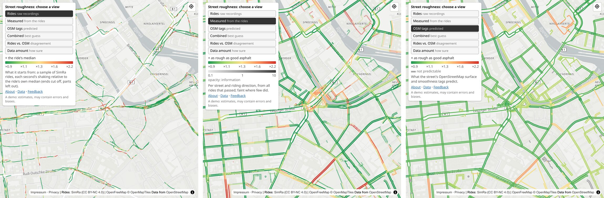
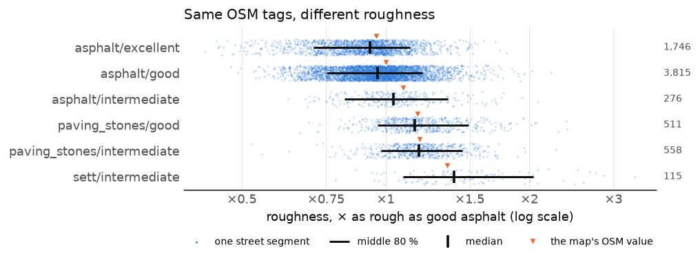

#  Velosense: street roughness from recorded bike rides

[](https://github.com/AndreasGerken/velosense/actions/workflows/tests.yml)

[](LICENSE)
[](https://maplibre.org/)
[](https://github.com/simra-project/dataset)
[](https://www.openstreetmap.org/copyright)

One roughness value per street segment and riding direction, measured from recorded bike rides (phone
accelerometer + GPS). OpenStreetMap's `surface` and `smoothness` tags fill in where few rides pass. It runs for any
region with recorded rides; the current map covers Berlin, with the rides of the
[SimRa](https://www.digital-future.berlin/forschung/projekte/simra/) project.

Velosense is meant as an open building block: open code and [open data](docs/data.md), roughness per OpenStreetMap
way and riding direction on one scale for every street and city, for bike routers, cities and mappers to build on.

**→ See the map at [velosense.org](https://velosense.org)**: a static page, nothing to install.



Berlin Mitte: a sample of the raw rides (left), the roughness measured from all rides per street (middle) and what
the OSM tags predict (right). Most streets here are tagged good asphalt; the rides show which of them ride rough.
Each riding direction is drawn on its own side of the street.

Roughness is shown as **"× as rough as good asphalt"**: ×1.5 shakes a bike 1.5 times as much as a street tagged
`surface=asphalt, smoothness=good` at the same speed. The map's views go the way the method does:

* **Rides**: what it starts from, a sample of the recorded rides, each second's shaking relative to its ride.
* **Measured**: per street and riding direction, from all rides that passed; faint where few did.
* **OSM tags**: what the street's surface and smoothness tags predict.
* **Combined**: both merged, each weighted by how sure it is: a value for every street.
* **Rides vs. OSM**: where the measurement and the tags disagree.
* **Data amount**: how much the measurement rests on.

How it's calculated, where every number comes from and how it's checked: [docs/how_it_works.md](docs/how_it_works.md).

## Building on OpenStreetMap

OpenStreetMap's volunteers have tagged the surface of 85 % of the ~23,000 km a bike may ride in Berlin, and its
smoothness on 47 %, by hand: on the ground, from photos, street by street. This map stands on that work: OSM gives
it the street network, the riding directions and the prediction wherever few rides pass.

Recorded rides add a measurement, on one scale for every street. The numbers below are a proof of concept, not a
final result: parts of the method and its calibration are still open (see *Outlook*).

* **Comparable** between streets and cities: `smoothness=good` is a judgement, made by many mappers in many places;
  a measured ×1.2 means the same everywhere. Among the well-measured streets tagged `asphalt/good`, the middle 80 %
  range from ×0.75 to ×1.20, the extremes from ×0.47 to ×2.27: a spread that a tag can't show (figure below).
* **Per riding direction**: each side of a street is measured on its own.
* **Up to date**: new rides count more than old ones, so the values follow the streets as they change.
* **Where to look again**: 6 % of the well-measured street directions (about 3,800) differ clearly from their tags
  (the *Rides vs. OSM* view). The street may have changed since it was tagged, or the tag was a close call: a hint for
  a mapper on the spot, not a correction.

<a href="docs/same_tags.md"></a>

Same tags, different roughness: each dot is a well-measured street segment, the orange marker the one value the
OSM view gives them all. More in [docs/same_tags.md](docs/same_tags.md).

## Data

Two downloads from the live map's *Data* window, described in [docs/data.md](docs/data.md):

* `roughness.csv.gz`: every measured street segment and riding direction, keyed by OSM way and nodes, with the
  measured, OSM and combined roughness, their uncertainties and the line (WKT).
* `tag_roughness.csv`: the roughness per OSM surface and smoothness tag pair, a ready cost table for a router.

A demo: the values may contain errors and biases (see *Outlook*). They come from SimRa rides and OpenStreetMap and
keep their licences (see *License*).

## Outlook

The map is a demo for now. To become infrastructure others build on:

* **Roughness in open routers** (BRouter, GraphHopper, Valhalla): routing with a comfort slider, from the fastest
  route to the smoothest one.
* **Routes that fill the gaps**: let routes include streets with few rides, so riders measure them on the way and
  the map grows by crowdsourcing.
* **Any region**: the pipeline runs wherever rides are recorded, with an OSM extract; Berlin is where the rides are
  now.
* **An open ride format**, so rides from any recording app can feed in, under an open licence (the SimRa rides
  allow no commercial use, which keeps the values out of commercial routers).
* **Back to OSM**: the clear disagreements as hints for mappers, e.g. as a MapRoulette challenge.
* **Better matching** where a road, its cycle track and a footway lie close together: rides can still land on the
  wrong one.
* **Cycle tracks without their own way**: where OSM maps a track only as tags on its road, riders on the road and on
  the track get one value.
* **Less bias**: slow streets and short segments (near junctions) still read somewhat rougher.

## Code

```
pipeline/   the steps (Python), config.py with every number, calibration.json with the fitted ones
web/        the map page: map.html, map.js, lib/ (MapLibre, PMTiles); tiles and downloads go to web/data/
docs/       how it works, the data, figures
tests/      tests on made-up data
data/       inputs and in-between files (not in the repository)
```

## Install

You need Python ≥ 3.12, [tippecanoe](https://github.com/felt/tippecanoe) ≥ 2.49 and about 16 GB of RAM.

```bash
python3 -m venv venv
venv/bin/pip install -r requirements.txt
```

Put the inputs into `data/` (symlinks are fine):

* `data/osm.pbf`: an OSM extract that covers the region; for Berlin,
  [Brandenburg](https://download.geofabrik.de/europe/germany/brandenburg.html) from Geofabrik.
* `data/simra_raw/`: the region's SimRa ride archives (`<region>_*.zip`), linked from
  [SimRa open data](https://github.com/simra-project/dataset) (DepositOnce). The current map uses the four Berlin
  archives from 10/2021 to 01/2025.

The region is set in [`pipeline/config.py`](pipeline/config.py) (`REGION`, `BBOX`, `LAT0`); it is Berlin now.

## Run

```bash
venv/bin/python pipeline/osm.py         # OSM -> street segments
venv/bin/python pipeline/simra.py       # rides -> one value per ride second
venv/bin/python pipeline/match.py       # ride seconds -> passes over the segments
venv/bin/python pipeline/calibrate.py   # passes -> calibration.json (fitted numbers)
venv/bin/python pipeline/estimate.py    # passes -> one value per segment and direction
venv/bin/python pipeline/tiles.py       # -> web/data/roughness.pmtiles, rides.pmtiles (the map)
venv/bin/python pipeline/export.py      # -> web/data/roughness.csv.gz, tag_roughness.csv (downloads)
```

All of Berlin takes about 8 minutes. Then serve `web/` and open the map:

```bash
cd web && ../venv/bin/python -m RangeHTTPServer 8770 --bind 127.0.0.1   # http://127.0.0.1:8770/map.html
```

The server must support HTTP Range requests; `python -m http.server` doesn't. The map's Impressum and Privacy links
point to pages of the deployed site, which are not part of this repository.

`pipeline/checks.py` checks the results, `pipeline/figures.py` draws the figures (`docs/same_tags.md`), and
`venv/bin/python -m pytest -q tests` runs the tests. `./run.sh <step>` runs a step in the background with a
memory cap.

## Privacy

No cookies, no tracking, no analytics services, no access log. The live site only counts page views and visitors
per day, anonymously (a hash with a random daily key, kept in memory). The scripts are served from the site itself
(`web/lib/`); only the base map comes from [OpenFreeMap](https://openfreemap.org/). The browser remembers the chosen view and whether the
welcome was shown, and nothing leaves it. The published values are averages per street segment and direction, with
no ride, time or route in them. The *Rides* view shows pieces of a sample of rides without times or ride ids: the
first and last 500 m of every ride and every other 500 m piece are left out, so no start, end or whole ride shows.

## Feedback

Wrong values, ideas, questions: GitHub issues, or the map's *Feedback* link.

## Credits

Built by [Andreas Gerken](mailto:info@agerken.de) with the support of [Claude Code](https://claude.com/claude-code).

## License

The code is under the [MIT License](LICENSE). The data it produces (estimates, tiles) comes from SimRa rides
([CC BY-NC 4.0](https://creativecommons.org/licenses/by-nc/4.0/), with the
[SimRa terms of use](https://github.com/simra-project/dataset)) and OpenStreetMap
([ODbL](https://www.openstreetmap.org/copyright)) and keeps their terms: attribution, no commercial use of the
ride-derived values, share-alike for the OSM data. SimRa's terms ask that published data can't be traced back to
riders; the values here are aggregated per street segment for that reason.

`web/lib/` holds [MapLibre GL JS](https://maplibre.org/) 4.7.1 and [PMTiles](https://github.com/protomaps/PMTiles) 3.2.1,
both BSD-3-Clause (license files next to them).
