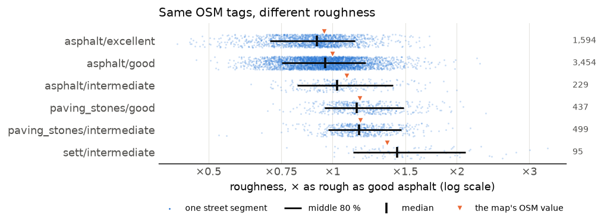

# Same tags, different roughness

OpenStreetMap's `smoothness` tag sorts streets into a few classes (`excellent`, `good`, `intermediate`, ...), each
judged by a mapper. The rides measure every street on one scale. Within one pair of `surface` and `smoothness` tags
the measured streets spread widely: among the 3,454 well-measured segments tagged `asphalt/good`, the middle 80 %
range from ×0.75 to ×1.20, the extremes from ×0.47 to ×2.27. The map's OSM view
gives each of them the same value.

> **A proof of concept, not a final result.** The numbers here are not exact yet: parts of the method are still open
> (matching where a road, its cycle track and a footway lie close together; cycle tracks mapped only as tags on their
> road; slow streets and short segments reading somewhat rougher), and its calibration may still change. They show
> that the method works and that streets with the same tags differ; the exact ranges and the values of single streets
> may still change.

Shown are only well-measured segments: information ≥ 10 (about ten new rides), a standard error of at most
×1.08 (small against the spread, so the spread is the streets', not noise), at least 30 m long
(short segments near junctions read rougher), tagged with both `surface` and `smoothness`; one riding direction per
segment, the better measured one. The tag pairs are the six with the most such segments, sorted by the map's OSM
value, smoothest first. Right: the number of segments.

| tag pair | segments | median | middle 80 % | lowest | highest | OSM value on the map |
|---|---|---|---|---|---|---|
| `asphalt/excellent` | 1,594 | ×0.92 | ×0.71 – ×1.13 | ×0.42 | ×1.72 | ×0.95 |
| `asphalt/good` | 3,454 | ×0.96 | ×0.75 – ×1.20 | ×0.47 | ×2.27 | ×1.00 |
| `asphalt/intermediate` | 229 | ×1.03 | ×0.82 – ×1.40 | ×0.63 | ×2.00 | ×1.08 |
| `paving_stones/good` | 437 | ×1.14 | ×0.96 – ×1.49 | ×0.70 | ×2.35 | ×1.16 |
| `paving_stones/intermediate` | 499 | ×1.16 | ×0.97 – ×1.47 | ×0.53 | ×2.16 | ×1.17 |
| `sett/intermediate` | 95 | ×1.43 | ×1.12 – ×2.10 | ×0.77 | ×3.32 | ×1.35 |

This doesn't make the tags wrong: a class is a range, and the measurement places each street within it, on a scale
that compares streets and cities. An extreme value is a hint to look again: the street may have changed since it was
tagged, or a ride was matched to the wrong way (a road and its cycle track side by side).
